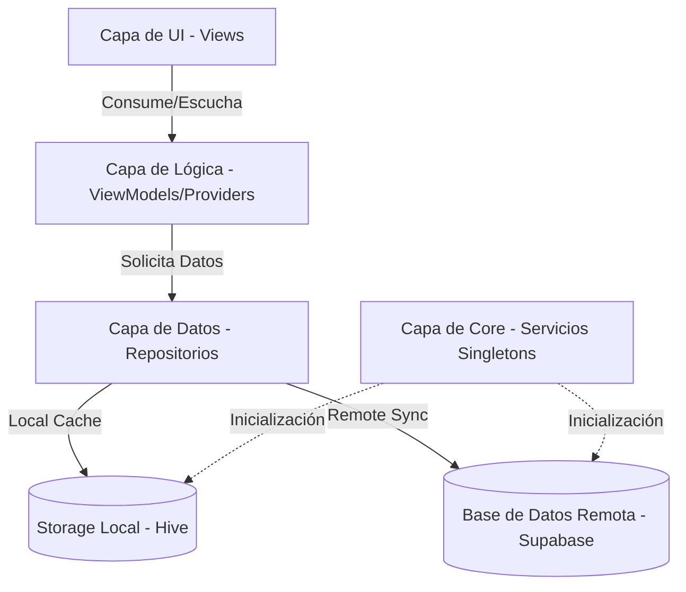

# CosechApp - Sistema de Control y Reportes de Cosecha (Palmito)

**CosechApp** es una aplicación multiplataforma (móvil y web) desarrollada en **Flutter** diseñada para ingenieros agrónomos. Su objetivo principal es facilitar el control de los ciclos de cosecha de palmito en campo, gestionar el desempeño de los programadores (extensionistas), realizar simulaciones de estimación de cosechas y automatizar la generación de reportes mensuales y trimestrales.

---

## 🛠️ Arquitectura y Patrones de Diseño

El proyecto implementa una arquitectura estructurada y desacoplada, siguiendo principios de código limpio (*Clean Code*) para facilitar el mantenimiento y la extensibilidad a futuro.



### 1. Patrón de Diseño MVVM (Model-View-ViewModel)
La separación de responsabilidades se implementa utilizando el patrón MVVM a través del gestor de estado **Provider**:
*   **Model (Modelos - `lib/data/models/`):** Define las estructuras de datos y cómo se mapean desde las respuestas JSON de Supabase y cómo se adaptan para el almacenamiento serializado local en Hive.
*   **View (Vistas/UI - `lib/ui/`):** Widgets y pantallas libres de lógica de negocio pesada. Solo se encargan de pintar la interfaz gráfica y notificar eventos del usuario.
*   **ViewModel/Provider (Lógica de Negocio - `lib/logic/providers/`):** Clases que extienden de `ChangeNotifier`. Manejan el estado de la aplicación, interactúan con los repositorios para cargar o modificar datos, aplican filtros de búsqueda y notifican a las vistas para que se redibujen cuando hay cambios.

### 2. Estrategia Offline-First (Sincronización Híbrida)
La aplicación está diseñada para operar de forma fluida en zonas rurales donde la conexión a internet es inestable o nula. Esto se logra mediante el repositorio `HarvestRepository` y la biblioteca **Hive**:
1.  **Verificación de Conectividad:** Al solicitar datos, se comprueba el estado de la red mediante `connectivity_plus`.
2.  **Modo Online:** Si hay conexión, se descargan los datos actualizados desde Supabase, se limpia el almacenamiento local y se guarda la nueva versión en la base de datos local (Hive).
3.  **Modo Offline:** Si no hay conexión o falla la consulta remota, la aplicación lee instantáneamente la copia en caché de Hive, asegurando que el ingeniero agrónomo siempre tenga acceso a la programación de cosechas en el campo.

### 3. Patrón Repository (Abstracción de Datos)
Los repositorios (`lib/data/repositories/`) actúan como mediadores entre las fuentes de datos (remota/local) y la lógica de la aplicación. Esto asegura que la lógica del negocio no dependa directamente de cómo o dónde se guarden los datos.

### 4. Patrón Singleton
Servicios compartidos como `SupabaseService` y `StorageService` se implementan como Singletons para garantizar que exista una única instancia de conexión a la base de datos remota y local durante todo el ciclo de vida de la aplicación.

---

## 📁 Estructura del Proyecto

A continuación se detalla la distribución de directorios dentro de la carpeta principal `lib/`:

```text
lib/
├── config/                  # Archivos SQL históricos e iniciales del proyecto.
├── core/                    # Núcleo de la aplicación (utilidades globales y servicios).
│   ├── services/            # Servicios persistentes e inicializaciones (Hive, Supabase).
│   └── utils/               # Traductores de errores de BD y utilidades visuales (Snackbars).
├── data/                    # Acceso a datos y modelado.
│   ├── models/              # Clases de datos y adaptadores auto-generados de Hive.
│   └── repositories/        # Gestión lógica de consultas locales y remotas.
├── logic/                   # Gestión de estado global.
│   └── providers/           # Controladores ChangeNotifier (Autenticación, Cosechas, Reportes).
├── ui/                      # Capa de presentación visual.
│   ├── common/              # Widgets pequeños y componentes reutilizables.
│   ├── layout/              # Estructura base de navegación de la aplicación (Shell principal).
│   └── screens/             # Pantallas de la aplicación (Login, Cosechas, Detalle, Reportes).
└── main.dart                # Inicialización de servicios, rutas e inyección de Providers.
```

---

## 🗄️ Modelo de Datos y Base de Datos (Supabase)

La base de datos remota está alojada en **Supabase** (PostgreSQL) y cuenta con un diseño optimizado para relaciones geográficas y de auditoría de cosechas.

### Tablas Principales
*   **`zones`:** Almacena las regiones o áreas geográficas de cultivo.
*   **`producers`:** Maestro de productores de palmito.
    *   *Restricción:* Única combinación de `full_name` y `zone_id` para evitar duplicidad regional.
*   **`harvest_records`:** Registro histórico y programación de las cosechas realizadas.

### Índices de Rendimiento
Para acelerar las búsquedas en grandes volúmenes de datos, la base de datos cuenta con índices específicos en:
*   `next_estimated_date` (Búsqueda rápida de fechas estimadas).
*   `status` (Filtrado ágil de tareas pendientes).
*   `full_name` (Autocompletado y búsqueda de productores).
*   `cut_date` (Optimización para agregaciones temporales en reportes).

### Vistas SQL de Análisis Automático
Para evitar que el dispositivo móvil consuma recursos procesando datos crudos, se implementaron vistas SQL optimizadas en Supabase:
1.  **`monthly_stats`:** Agrupa la producción (`quantity_processed`) por año y mes para trazar la tendencia histórica.
2.  **`stats_zone_distribution`:** Consolida los kilos recibidos y procesados agrupados por zonas.
3.  **`production_summary_report`:** Calcula la producción mensual consolidada de los programadores (días de cosecha, cogollos totales, porcentaje de descarte, rendimiento de procesamiento y porcentaje de participación del mercado en ese mes).
4.  **`programmer_detail_report`:** Aplana las relaciones entre cosechas, productores y zonas para presentar tablas de auditoría detalladas listas para visualizar y exportar.

---

## 📱 Módulos y Flujos Clave de la Aplicación

### 1. Autenticación y Control de Rutas (`GoRouter`)
*   Se utiliza `GoRouter` para la navegación declarativa.
*   Existe un filtro de redirección activa (*redirection guard*) en `main.dart` que evalúa la sesión del cliente de Supabase. Si no existe sesión, redirige inmediatamente a la pantalla de `/login`; si existe sesión activa, impide el acceso al login y redirige a `/home`.

### 2. Panel de Cosechas y Filtros Dinámicos
*   **Filtro Temporal Inicial:** La lista de cosechas del Home implementa un filtro inteligente por defecto que muestra registros desde hace 3 días en adelante (fecha estimada), evitando saturar la UI con información de visitas muy antiguas si no se ha seleccionado un mes específico.
*   **Barra de Filtros:** Permite segmentar dinámicamente la vista por Mes de Corte (`MM-yyyy`), Zona geográfica y Programador. Al seleccionar filtros, se recalculan las listas del `HarvestProvider` de forma inmediata.
*   **Tarjetas de Cosecha Reactivas:** Cambian sus colores de borde y etiquetas según la urgencia del ciclo:
    *   *Rojo Sangre:* Atrasado (la fecha estimada ya pasó).
    *   *Naranja:* Por visitar (faltan 7 días o menos y el estado es pendiente).
    *   *Verde:* Pendiente regular.
    *   *Morado/Azul:* Visitado o Cosechado.
    *   *Rojo:* Cancelado.

### 3. Simulación de Ciclos en Detalle (`HarvestDetailScreen`)
El ingeniero agrónomo puede acceder al detalle de un ciclo pendiente para:
*   **Modificar el ciclo estimado (3 o 4 meses):** La aplicación recalcula visualmente la fecha estimada del próximo corte en tiempo real.
*   **Ajuste automático de fin de semana:** Si el nuevo cálculo estimado recae en un día domingo, el sistema recorre automáticamente la fecha estimada al día lunes.
*   **Acciones Directas:** Registrar que el campo ya fue visitado (`VISITED`), confirmar la cosecha (`HARVESTED`) o cancelar el ciclo (`CANCELLED`) ingresando un motivo de observación de campo (plagas, heladas, venta a terceros, etc.).

### 4. Centro de Reportes y Exportación a Excel
*   **Reportes Mensuales:** Muestra tablas interactivas con el resumen de producción de los extensionistas y el reporte detallado de programación. Ambas pantallas cargan información consolidada desde las vistas de Supabase y calculan una fila dinámica de **TOTALES** al final de la tabla.
*   **Generación de archivos `.xlsx`:** Utilizando la biblioteca `excel`, se formatean los datos del reporte agregando cabeceras, registros numéricos correctos y filas consolidadas.
*   **Compartición Nativa:** Los archivos de Excel generados se guardan localmente en la carpeta de documentos de la aplicación y se abren automáticamente en el menú de compartir nativo del dispositivo (WhatsApp, Correo, Drive) mediante la librería `share_plus`.

### 5. Carga Masiva Inteligente (`ImportHarvestScreen`)
Permite a la secretaría o al administrador cargar la producción del mes arrastrando o seleccionando un archivo de Excel (`.xlsx` o `.xls`):
1.  **Lectura en memoria:** Ideal para dispositivos móviles y web sin necesidad de escribir en disco antes de procesar.
2.  **Detección de periodo:** Analiza las fechas del Excel para identificar el mes y año que se está importando.
3.  **Prevención de duplicados (Reemplazo Mensual):** Si el sistema detecta que ya existen registros cargados en Supabase para el mes y año identificado, despliega un cuadro de diálogo de advertencia preguntando al usuario si desea sobrescribir el periodo. Si el usuario confirma, la aplicación realiza un borrado en cascada del mes objetivo antes de subir la información nueva, previniendo datos duplicados o registros huérfanos.
4.  **Inserción Masiva (Bulk Upsert):** Procesa y sube secuencialmente los datos estructurados respetando las restricciones de base de datos (crea zonas si no existen, asocia productores nuevos de forma automática y sube los registros en un solo lote rápido).

### 6. Dashboard Trimestral
Ubicado en el Centro de Reportes bajo la pestaña "Trimestral", se alimenta del `QuarterlyDashboardProvider` para ofrecer:
*   **Filtros Trimestrales:** Búsqueda rápida por Año y Trimestre (T1 a T4).
*   **Comparativa de Rendimiento (KPIs):** Calcula la variación porcentual con respecto al trimestre anterior señalando incrementos positivos (verde ▲) o caídas (rojo ▼).
*   **Métricas de Eficiencia:** Calcula de forma automática la relación porcentual entre los cogollos procesados y los recibidos en planta.
*   **Gráficos Interactivos (`fl_chart`):** Visualizaciones dinámicas que cambian mediante un control segmentado superior:
    *   *Tendencia:* Gráfico de barras mensual de kilos procesados dentro del trimestre.
    *   *Zonas:* Gráfico de barras horizontales/progreso para la distribución de peso procesado por zona de origen.
    *   *Equipo:* Rendimiento del equipo de extensionistas encargado del palmito.

---

## 🚀 Guía de Extensibilidad (Para el Desarrollador)

### ¿Cómo agregar una nueva pantalla o funcionalidad?
1.  **Definir el Modelo:** Si necesitas un nuevo tipo de dato, crea tu archivo en `lib/data/models/`. Si va a almacenarse localmente, añade las anotaciones `@HiveType` y `@HiveField`, y ejecuta el comando de build_runner para generar el adaptador `.g.dart`:
    ```bash
    flutter pub run build_runner build --delete-conflicting-outputs
    ```
    No olvides registrar el nuevo adaptador en `lib/core/services/storage_service.dart`.
2.  **Crear el Repositorio:** Define la lógica de obtención y envío de datos en `lib/data/repositories/`. Utiliza el servicio `SupabaseService` para interactuar con la nube y añade la lógica de respaldo local de ser necesario.
3.  **Implementar el Provider:** Crea el controlador en `lib/logic/providers/` heredando de `ChangeNotifier`. Registra tu provider en el `MultiProvider` que se encuentra en `lib/main.dart` para que pueda ser consumido por las pantallas.
4.  **Desarrollar la UI:** Añade tus widgets en `lib/ui/screens/` y conéctalos mediante `context.watch<TuProvider>()` o `context.read<TuProvider>()` según corresponda para mantener una UI reactiva y limpia.
5.  **Configurar Rutas:** Si la pantalla requiere navegación directa, agrégala al listado de rutas en `lib/main.dart` usando `GoRoute`.

### Actualización de Gráficos o Consultas SQL
Si requieres añadir nuevas gráficas o reportes complejos, la recomendación principal es **crear una vista SQL (View) o una función en Supabase**. Esto mantiene la aplicación liviana, ya que toda la carga matemática se ejecuta del lado del servidor de base de datos de Supabase, y la app en Flutter simplemente consume un JSON plano estructurado.

---
© 2026 Jhon E. Tapia Vargas. Todos los derechos reservados. Software propietario y confidencial.